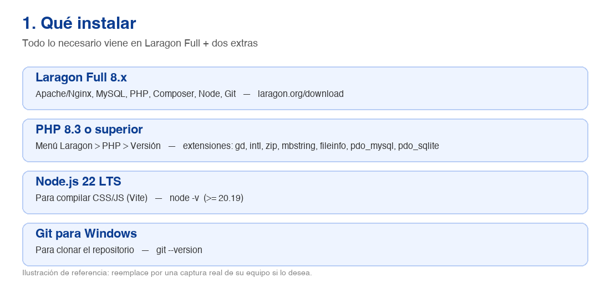
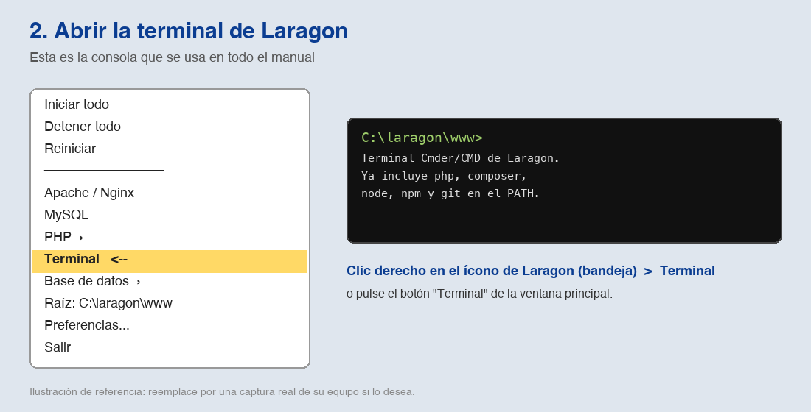
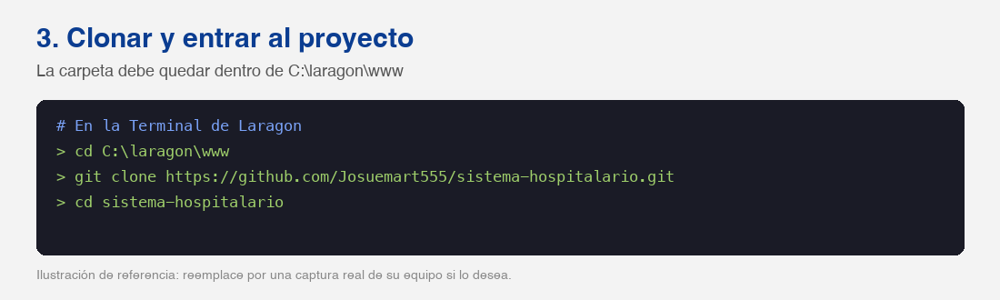
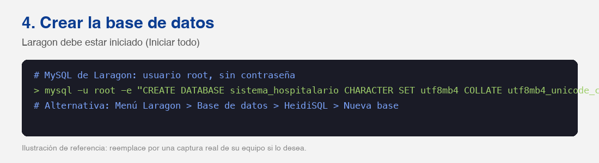
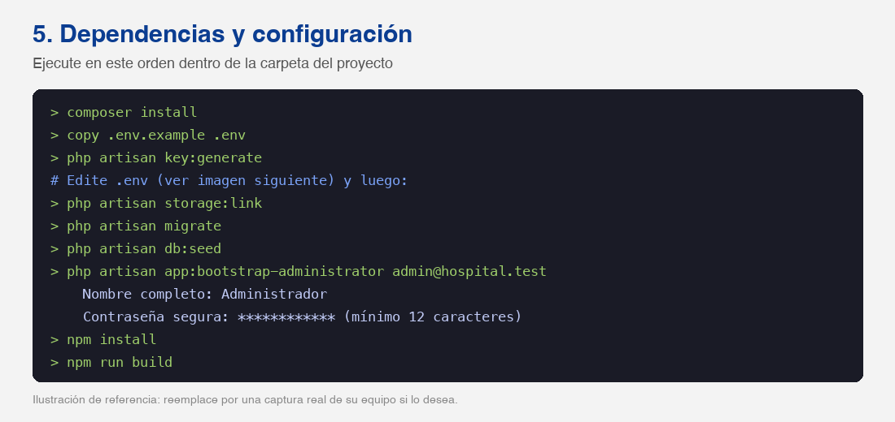
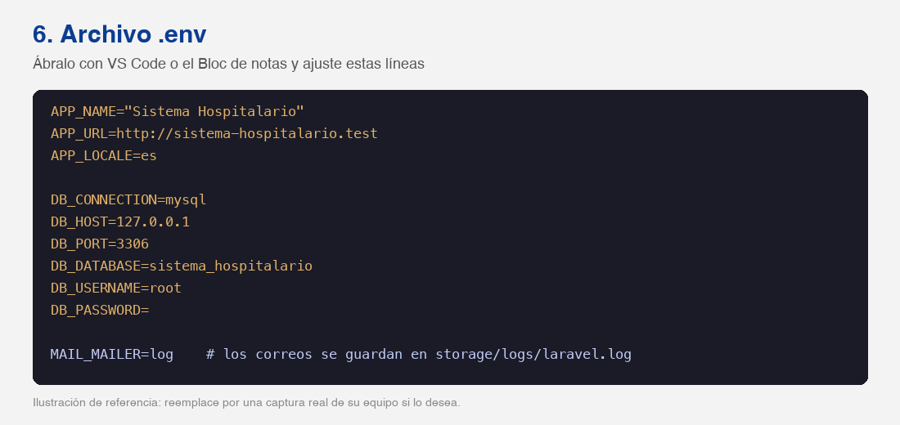
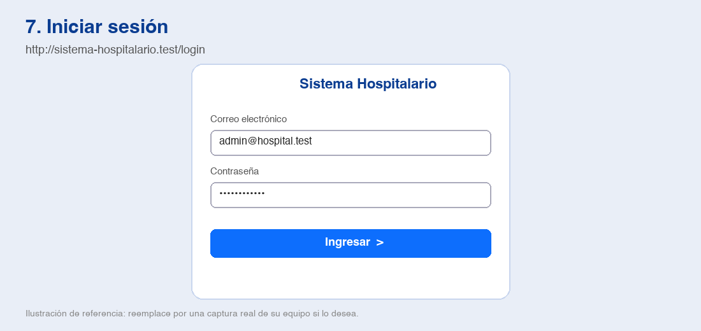

# Manual de instalación en Windows con Laragon

Sistema Hospitalario (Laravel 13, PHP 8.3+, MySQL, Vite). Esta guía explica, paso a paso, cómo dejar el proyecto funcionando en un equipo Windows con Laragon y cómo iniciar sesión por primera vez.

> Las imágenes son ilustraciones de referencia de cada paso, no capturas reales de su equipo.


## 1. Qué hay que instalar



- **Laragon Full** (versión 8 o superior): https://laragon.org/download. Incluye Apache/Nginx, MySQL, PHP, Composer, Node.js y Git.
- **PHP 8.3 o superior.** Verifique con el menú de Laragon > PHP > Versión. Si no aparece, descargue PHP 8.3/8.4 desde https://windows.php.net/download y cópielo en `C:\laragon\bin\php`.
- **Extensiones de PHP activas** (menú Laragon > PHP > Extensiones): `gd`, `intl`, `zip`, `mbstring`, `fileinfo`, `openssl`, `curl`, `pdo_mysql` y `pdo_sqlite`.
- **Node.js 22 LTS** (mínimo 20.19) para compilar CSS y JavaScript. Verifique con `node -v`.
- **Git para Windows** y acceso al repositorio de GitHub del proyecto.


## 2. Abrir la terminal de Laragon

Todos los comandos se ejecutan en la **Terminal de Laragon**, no en el CMD de Windows ni en PowerShell, porque ya trae `php`, `composer`, `node`, `npm` y `git` en el PATH.



- Abra Laragon y pulse **Iniciar todo** (Apache/Nginx y MySQL en verde).
- Pulse el botón **Terminal** de la ventana principal, o clic derecho sobre el ícono de Laragon en la bandeja > **Terminal**.
- Compruebe las versiones: `php -v` (8.3 o superior), `composer -V`, `node -v` y `git --version`.


## 3. Clonar el proyecto



Clone dentro de `C:\laragon\www` para que Laragon cree el dominio automáticamente.

```bash
cd C:\laragon\www
git clone https://github.com/Josuemart555/sistema-hospitalario.git
cd sistema-hospitalario
```

Con **Auto virtual hosts** activado (Preferencias > General), el sitio quedará en `http://sistema-hospitalario.test`. Si no aparece, pulse **Reiniciar** o menú > Apache > Reload.


## 4. Crear la base de datos



El MySQL de Laragon usa el usuario `root` sin contraseña.

```bash
mysql -u root -e "CREATE DATABASE sistema_hospitalario CHARACTER SET utf8mb4 COLLATE utf8mb4_unicode_ci;"
```

También puede crearla con el menú Laragon > Base de datos > HeidiSQL (botón derecho > Crear nueva > Base de datos).


## 5. Instalar dependencias y configurar



Estando dentro de la carpeta del proyecto, ejecute:

```bash
composer install
copy .env.example .env
php artisan key:generate
```

Ahora edite el archivo `.env` (siguiente imagen). Por defecto viene configurado para SQLite; hay que cambiarlo a MySQL.



```bash
APP_NAME="Sistema Hospitalario"
APP_URL=http://sistema-hospitalario.test
APP_LOCALE=es

DB_CONNECTION=mysql
DB_HOST=127.0.0.1
DB_PORT=3306
DB_DATABASE=sistema_hospitalario
DB_USERNAME=root
DB_PASSWORD=

MAIL_MAILER=log
```

> Con MAIL_MAILER=log los correos no se envían: se guardan en storage\logs\laravel.log. Para enviarlos de verdad con Resend, agregue RESEND_API_KEY=su_clave y cambie MAIL_MAILER=resend. Nunca suba el archivo .env a Git.


## 6. Migraciones, seeders y primer usuario

Estos comandos crean las tablas, los permisos/roles/menú iniciales y el usuario administrador:

```bash
php artisan storage:link
php artisan migrate
php artisan db:seed
php artisan app:bootstrap-administrator admin@hospital.test
```

- `migrate` crea todas las tablas en la base `sistema_hospitalario`.
- `db:seed` crea el rol **Super Administrador**, los permisos y las opciones del menú (Inicio, Administración > Usuarios, Roles, Permisos, Opciones del menú).
- `app:bootstrap-administrator` pregunta el **nombre completo** y una **contraseña de al menos 12 caracteres**, crea el usuario activo y le asigna el rol Super Administrador. Puede cambiar el correo del ejemplo por el suyo.
- `storage:link` publica la carpeta de fotos de perfil.

> Si necesita repetir todo desde cero: php artisan migrate:fresh --seed y vuelva a ejecutar app:bootstrap-administrator. Esto borra todos los datos.


## 7. Compilar el frontend

```bash
npm install
npm run build
```

- `npm run build` genera los archivos finales en `public/build`. Es lo recomendado para probar y para producción.
- Para desarrollar con recarga en vivo use `npm run dev` y deje esa terminal abierta. Si después vuelve a `npm run build` y las páginas siguen cargando desde el servidor de desarrollo, elimine el archivo `public\hot`.


## 8. Iniciar sesión



- Abra http://sistema-hospitalario.test/login (o `php artisan serve` y http://localhost:8000/login).
- Ingrese el correo y la contraseña que definió en el paso 6.
- Como Super Administrador verá el menú **Administración** para gestionar usuarios, roles, permisos y opciones del menú.
- Al crear usuarios desde **Administración > Usuarios**, el administrador define la contraseña en el formulario; no se envía ningún correo.


### Verificación en dos pasos por correo

Si en un usuario activa **Exigir código de verificación por correo al iniciar sesión**, después de la contraseña se pedirá un código de 6 dígitos. Con `MAIL_MAILER=log` el código se encuentra dentro de `storage\logs\laravel.log` (busque "Su código de verificación"). Con Resend, llega al correo del usuario; el remitente `onboarding@resend.dev` solo entrega al dueño de la cuenta de Resend hasta que se verifique un dominio propio.


## 9. Ejecutar las pruebas (opcional)

```bash
php artisan test
```

Las pruebas usan SQLite en memoria (requiere la extensión `pdo_sqlite`) y no tocan su base MySQL.


## 10. Problemas frecuentes

- **`could not find driver`**: active `pdo_mysql` (o `pdo_sqlite`) en menú Laragon > PHP > Extensiones y reinicie.
- **`Your PHP version does not satisfy the requirement`** o dependencias que exigen PHP 8.3: cambie la versión en menú Laragon > PHP > Versión y abra una terminal nueva.
- **`Vite manifest not found`** o la página sale sin estilos: ejecute `npm run build` (o `npm run dev`).
- **`SQLSTATE[HY000] [1049] Unknown database`**: falta crear la base (paso 4) o el nombre en `.env` no coincide.
- **`No application encryption key`**: ejecute `php artisan key:generate`.
- **Cambió el `.env` y no se aplica**: ejecute `php artisan config:clear`.
- **El dominio `.test` no abre**: verifique Auto virtual hosts, reinicie Laragon y compruebe que Apache/Nginx esté en el puerto 80 (si otro programa lo usa, cambie el puerto en Preferencias).
- **Las fotos de perfil no se ven**: ejecute `php artisan storage:link`.
- **Olvidó la contraseña del administrador**: vuelva a ejecutar `php artisan app:bootstrap-administrator su@correo.com` con el mismo correo; actualiza su contraseña.


### Resumen rápido de comandos

```bash
cd C:\laragon\www
git clone https://github.com/Josuemart555/sistema-hospitalario.git
cd sistema-hospitalario
mysql -u root -e "CREATE DATABASE sistema_hospitalario CHARACTER SET utf8mb4 COLLATE utf8mb4_unicode_ci;"
composer install
copy .env.example .env
php artisan key:generate
:: edite .env (MySQL, APP_URL, APP_LOCALE)
php artisan storage:link
php artisan migrate
php artisan db:seed
php artisan app:bootstrap-administrator admin@hospital.test
npm install
npm run build
```
